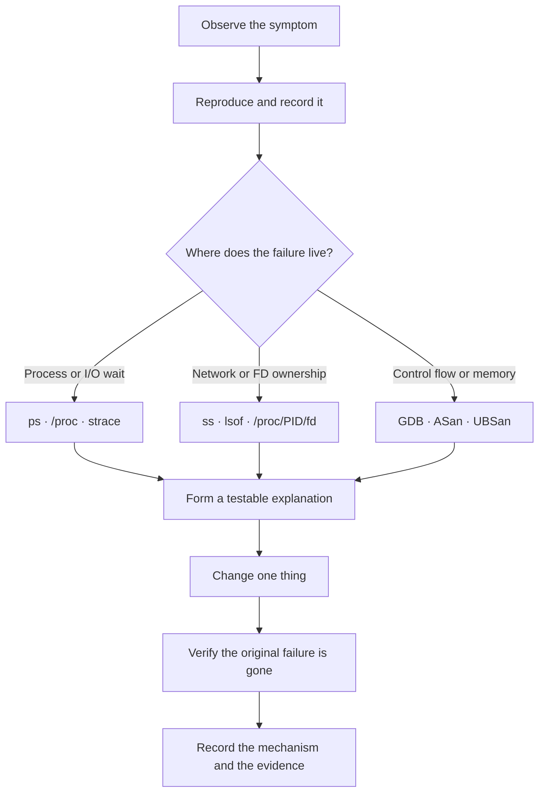

<p align="center"><sub>LINUX SYSTEMS ENGINEERING LAB · MODULE 05 / SECTION 02</sub></p>

# The Debugger's Notebook
### Field notes on processes, memory, and the things Linux doesn't tell you outright

*Ubuntu / WSL2 · C · GCC · GDB · Linux userspace*

---

A BMS collector prints `BMS CELL01=3300mV`. Its telemetry worker has exited. The data is correct. And yet the application takes seven seconds to finish.

There is no crash, no error message, and no broken telemetry. The answer is an open file descriptor in a different process.

That was the recurring lesson of this section: **a symptom is not a diagnosis**. To understand a failure, I had to stop guessing from application output and start collecting evidence from the kernel, the process tree, memory instrumentation, and the source code.

This is the field notebook from those investigations. It is meant to be read in order the first time, and consulted by symptom afterward.

**Open a chapter:** [01 · The method](#chapter-01--the-method) · [02 · The instruments](#chapter-02--the-instruments) · [03 · The casebook](#chapter-03--the-casebook) · [04 · Open the evidence](#chapter-04--open-the-evidence) · [05 · Take it to the terminal](#chapter-05--take-it-to-the-terminal)

---

## Chapter 01 · The method

### Three stories, one bug

Every investigation begins with three versions of reality.

**What the application says.** A heartbeat stopped. A frame was rejected. A process “finished.” These are observations, but may hide the important detail.

**What Linux actually did.** The kernel returns `ECONNREFUSED`, leaves a task sleeping in `anon_pipe_read`, or keeps a signal pending. System calls, process state, and descriptor ownership give us evidence.

**What the code assumed.** One `read()` would deliver a full frame. An exited writer would guarantee EOF. A listener on one loopback address would accept connections on another. Often the assumption—not the syscall—is wrong.

The workflow I now use is simple:



For each case, the notebook asks the same questions: *What failed? Where did it stop? What resource or value mattered? What proves the fix?*

> **Rule of evidence:** `<unfinished ...>` is not a failed syscall; `S` is not automatically a deadlock; a successful `write()` is not necessarily a complete application message.

---

## Chapter 02 · The instruments

These are not commands to memorize in isolation. Each one answers a different investigative question.

### 1. Is the process alive, and what is it waiting for?

```bash
ps -o pid,ppid,stat,%cpu,wchan:24,comm -p "$pid"
ps -L -p "$pid" -o pid,tid,stat,wchan:26,comm
ps -o pid,ppid,stat,wchan:24,comm -p "$parent" --ppid "$parent"
```

`ps` is the first look at the scene. `STAT` tells us whether a task is runnable (`R`), sleeping (`S`), stopped (`T`), or a zombie (`Z`). A `D` state denotes uninterruptible sleep. `WCHAN` identifies the kernel wait site where available.

During the labs, `hrtimer_nanosleep` meant a deliberate sleep; `inet_csk_accept` meant a TCP listener waiting for a client; `anon_pipe_read` pointed toward blocked pipe I/O. A futex-related wait could mean a mutex, a thread join, or normal contention. **The wait site narrows the search; it does not finish it.**

A process that vanishes from `ps` has probably exited before the snapshot. If timing matters, capture evidence *while it is still alive*.

### 2. What did the program ask the kernel to do?

```bash
strace -f -tt -T -yy -s 128 -o trace.log ./program
```

I use `strace` when program behavior and source-level expectations disagree. Its most useful switches here are `-f` (follow child processes), `-tt` (timestamps), `-T` (syscall duration), `-yy` (decode file-descriptor targets), and `-o` (write evidence to a file).

For a narrower experiment:

```bash
strace -f -tt -T -yy \
  -e trace=read,write,close,poll,pipe2,clone,execve,wait4 \
  -o io.trace ./program
```

The important thing is **the return value**:

```text
openat(..., "/missing/device", ...) = -1 ENOENT
poll(..., 1000)                  = 0 (Timeout)
read(3<pipe:[110706]>, ..., 64)  = 18
connect(... 127.0.0.2:47631 ...) = -1 ECONNREFUSED
```

`ENOENT` is a missing pathname; `poll() = 0` is a timeout; a positive `read()` result is the number of bytes *actually* read. An error code deserves interpretation in the context of that specific call.

<details>
<summary><strong>A strace notation that fooled me: unfinished vs. failed</strong></summary>

```text
clone(... <unfinished ...>
<... clone resumed>, ...) = 8988
```

This is **one successful** fork-like operation: another traced process ran between the beginning and end of the printed line. The parent got child PID `8988`. Failure would instead be a negative result such as `= -1 EAGAIN`.

Similarly, `execlp("sleep", ...)` can search several `PATH` locations. Earlier `execve() = -1 ENOENT` attempts are not the final outcome when a later `execve("/usr/bin/sleep", ...) = 0` succeeds.

</details>

<details>
<summary><strong>Another trap: not every write is telemetry</strong></summary>

```text
write(4<UNIX-STREAM:[...]>, "\245Z\10", 3) = 3
write(2</dev/pts/6>, "SENDER: transmitted first segment\n", 34) = 34
```

The first call sent **three bytes through the socket**. The second printed a **34-byte log message to stderr**, FD 2. Counting every `write()` result together can produce a completely false diagnosis.

</details>

If a trace of GNU `cat` appears to transfer no data, check `splice()`; not every copy is implemented as `read()` followed by `write()`. `strace -c` is useful for syscall counts, but its percentages are **not CPU utilization**.

### 3. Who owns the resource that won't go away?

```bash
ls -l "/proc/$pid/fd"
readlink "/proc/$pid/fd/3"
lsof -nP -p "$pid"
lsof -nP /path/to/telemetry.log
```

An FD number only has meaning inside its process. Two processes can each have FD 4, and those FDs might refer to the same pipe, separate files, or unrelated sockets. Compare targets such as `pipe:[110706]` to establish identity.

This mattered most in the final investigation: **an EOF is not delivered to a pipe reader until every open reference to the pipe's write end has been closed**. A child that never writes a byte can still prevent EOF merely by inheriting a write descriptor.

`fork()` inherits open descriptors; `execve()` normally preserves them unless they have the close-on-exec flag (`FD_CLOEXEC`). That rule explains many “impossible” hangs.

### 4. Is the server listening where the client thinks it is?

```bash
ss -ltnp | grep ':47631'
lsof -nP -iTCP:47631
strace -e trace=socket,bind,listen,accept,connect \
  -o network.trace ./tcp_bms_lab client
```

`ss` answers which sockets exist and which **local** endpoints are listening. `lsof` identifies their owners. `strace` reveals the destination passed to `connect()`.

A TCP endpoint is an **IP address plus a port**. `127.0.0.1:47631` and `127.0.0.2:47631` are not interchangeable. And `0.0.0.0:*` under the *peer* column of a listening socket is not its local bind address.

### 5. Where did execution go wrong?

For control flow and variable inspection, build with debug symbols:

```bash
gcc -std=c11 -Wall -Wextra -Wpedantic -Werror \
  -g -O0 program.c -o program

gdb -q ./program
```

```text
(gdb) break parse_frame
(gdb) run
(gdb) bt
(gdb) info args
(gdb) info locals
(gdb) next
(gdb) print i
(gdb) x/8xb frame
```

`bt` shows the call stack; `next` advances the current source line; `x/8xb` inspects eight bytes in hexadecimal. With threads, `info threads` and `thread apply all bt` reveal which thread is joining, locking, or waiting at a barrier.

**The time of inspection matters.** In the parser lab, GDB displayed meaningless local values because the breakpoint was *before initialization*. In the stream lab, stopping at a breakpoint gave the sender time to finish, changing a three-byte read into an eight-byte read. Debugging can change scheduling.

### 6. Is memory being accessed outside its lifetime or bounds?

```bash
gcc -std=c11 -Wall -Wextra -Wpedantic -Werror \
  -g -O0 -fno-omit-frame-pointer \
  -fsanitize=address,undefined program.c -o program_asan

./program_asan
```

AddressSanitizer (ASan) helped identify a **use-after-free** and a **two-byte heap-buffer-overflow**. Read the invalid-access stack, `READ` or `WRITE` size, the allocation/free stack, and where the address lies relative to the allocated region. UBSan diagnoses selected undefined behaviors.

ThreadSanitizer (TSan) targets data races, using a **separate** build with `-fsanitize=thread -pthread`. A clean sanitizer run on one input is evidence about that run, not proof of universal correctness.

A useful pairing: **ASan identifies the illegal access; GDB explains how the control flow reached it.**

### 7. Is it a CPU problem, a blocked wait, or a service-level event?

```bash
time ./program
strace -c ./program
journalctl -t module5-bms --no-pager
dmesg | tail -n 40
```

`time` separates elapsed `real` time from `user` and `sys` CPU time. A program can take seven seconds while consuming almost no CPU because it's waiting. In contrast, `poll(..., 0)` in a tight loop can burn a core without useful work.

`journalctl` is for journal events; `dmesg` is for kernel messages. Match timestamps and PIDs before attributing an old warning to a current failure. When choosing between these tools and a CPU profiler, ask whether the process is *working too hard* or *waiting too long*.

### 8. Was a shutdown signal delivered?

```bash
kill -TERM "$pid"
grep -E '^(SigPnd|ShdPnd|SigBlk|SigIgn|SigCgt):' \
  "/proc/$pid/status"
strace -e trace=rt_sigaction,rt_sigprocmask \
  -o signals.trace ./program
```

These `/proc` fields are **hexadecimal signal masks**. `SigPnd` and `ShdPnd` mean pending, `SigBlk` means blocked, `SigIgn` means ignored, and `SigCgt` means a handler is installed. SIGTERM is signal 15, so its bit is `1 << 14` or `0x4000`.

A successful `kill -TERM` means the signal was sent; it does not guarantee shutdown. In the lab, `ShdPnd=SigBlk=SigCgt=0x4000` showed that SIGTERM was pending and caught but **blocked from delivery**. Blocking is useful in deliberate signal-handling designs, but the lab's permanent block was intentionally contrived.

---

## Chapter 03 · The casebook

One line per investigation: *what failed, what gave it away, what changed*. Open a source file to repeat a lab; **some files deliberately preserve their faulty version**.

| Case | Failure under investigation | Evidence that mattered | Repair or lesson |
| :--- | :--- | :--- | :--- |
| [Serial probe](lesson-01/serial_probe.c) | Device path missing | `openat() = -1 ENOENT` | Check path/device existence before blaming I/O logic |
| [Polling exercise](lesson-03/poll_demo.c) | Timeout, EAGAIN, POLLIN, POLLHUP | `poll` and `read` results | Distinguish readiness, timeout, hangup, and EOF |
| [Frame lifetime](lesson-06/frame_lifetime.c) | Use-after-free | ASan allocation/free/access stacks | Use data before freeing it |
| [Final lab](final-lab/telemetry_hang.c) | Blocks after poll timeout | `WCHAN=anon_pipe_read` and `read()` | A timeout is not permission for a blocking read |
| [#2 · Reconnect](challenge-02/reconnect_lab.c) | File-descriptor leak | Repeated opens → `EMFILE` | Close FD on the EOF/early-return path |
| [#3 · CPU](challenge-03/cpu_lab.c) | Busy polling | High `%CPU`; `poll(...,0)` loop | Wait for events instead of spinning |
| [#4 · Supervisor](challenge-04/worker_supervisor.c) | Zombie children | `ps` shows `Z`; parent lacks reap | Collect child status with `waitpid()` |
| [#5 · Workers](challenge-05/worker_lock_lab.c) | Mutex deadlock | Futex waits; opposing lock order | Consistent order, with barrier outside locked region |
| [#6 · Stream](challenge-06/telemetry_stream_lab.c) | Short stream read | 3+5 writes; first read got 3 | Accumulate bytes to frame length |
| [#7 · TCP](challenge-07/tcp_bms_lab.c) | Connection refused | `ss`: 127.0.0.1; `connect`: 127.0.0.2 | Match the actual listening endpoint |
| [#8 · Parser](challenge-08/bms_parser_lab.c) | Heap-buffer-overflow | ASan: 2-byte write past 6-byte allocation | Stop loop at `i < cell_count` |
| [#9 · Shutdown](challenge-09/shutdown_lab.c) | Signal never handled | Pending and blocked SIGTERM | Fix signal-mask lifecycle; artificial lab |
| [#10 · Collector](challenge-10/collector_lab.c) | EOF delayed ~7 seconds | Pipe FD inherited by diagnostics child | Close unused writer before `exec` |
| [Extra investigation](final-investigation/bms_hang.c) | Pipe reader may wait indefinitely | Parent keeps a write descriptor | Inspect FD closure; source-only example |

In addition to the files above, the terminal exercises covered FIFO transfers through `splice()`, finding a process holding an open log with `lsof`, inspecting a Python TCP listener with `ss`, and correlating journal messages with their sources.

The **casebook is a record of investigations, not a claim that every checked-in lab now passes**. In particular, the current `#5`, `#8`, and `#9` source files still exhibit their intended failures. The fixed receiver in `#6`, the corrected TCP endpoint in `#7`, and the corrected descriptor closure in `#10` are present in the checked-in files.

---

## Chapter 04 · Open the evidence

A small exercise: read the evidence first, decide what you think is wrong, then expand the case note. These aren't quizzes with hidden gimmicks—the clues are from the actual sessions.

<details>
<summary><strong>Case note A · The receiver got three bytes. Did the sender fail?</strong></summary>

**Evidence**

```text
sender: write(socket, ..., 3) = 3
receiver: read(socket, ..., 8) = 3
sender: write(socket, ..., 5) = 5
```

**Finding.** Both writes succeeded. A stream socket does not preserve application-message boundaries. The receiver assumed one read equaled one frame and rejected data too early.

**Correction.** Read repeatedly into the remaining part of the buffer, stopping at the expected length, EOF, or a real error. The corrected program returned a complete eight-byte frame and passed 20 repeated runs.

**The surprise.** GDB changed timing: by the time the paused receiver resumed, all eight bytes were available. The program's output changed, but the stream contract did not.

</details>

<details>
<summary><strong>Case note B · A server was listening. Why was the connection refused?</strong></summary>

**Evidence**

```text
ss:      LISTEN 127.0.0.1:47631
strace:  connect(... 127.0.0.2:47631 ...) = -1 ECONNREFUSED
```

**Finding.** The port matched; the IP address did not. The server was not bound to the address the client requested.

**Correction.** Point the client at `127.0.0.1`. Retrying the wrong destination would not resolve the configuration error.

</details>

<details>
<summary><strong>Case note C · Six allocated bytes, a two-byte write. Where did it go?</strong></summary>

**Evidence**

```text
calloc(3, sizeof(uint16_t))           // 6 bytes
for (size_t i = 0; i <= cell_count; ++i)
ASan: WRITE of size 2
      0 bytes after 6-byte region
```

**Finding.** Indices `0`, `1`, and `2` were valid; `i=3` wrote to `cells[3]` outside the allocation. The input frame was not itself the overflowing allocation.

**Correction.** `i < cell_count`. The repository version remains intentionally faulty, so it is still usable as an ASan exercise.

</details>

<details>
<summary><strong>Case note D · The worker exited. Who held the pipe open?</strong></summary>

**Evidence**

```text
COLLECTOR received 18 bytes; awaiting stream completion
real 0m7.023s
read(3<pipe:[110706]> <unfinished ...>
... diagnostics process runs sleep 7 ...
COLLECTOR EOF reached
```

**Finding.** The telemetry worker had finished, but the diagnostics child had inherited the pipe's write end. Its only connection to the telemetry system was an FD it never needed. The read could not return EOF until that reference disappeared.

**Correction.** Close the unused pipe end in the diagnostics child before `execlp()`. This was tested successfully. The lesson is about **ownership**, not about the length of the diagnostic sleep.

</details>

---

## Chapter 05 · Take it to the terminal

### A pocket field kit

Open the situation closest to your current problem. Start with the suggested observation; don't immediately edit source code.

<details>
<summary><strong>The program seems frozen</strong></summary>

```bash
ps -o pid,ppid,stat,wchan:24,comm -p "$pid"
ls -l "/proc/$pid/fd"
strace -f -tt -T -yy -p "$pid"
```

Ask: *Is it asleep on I/O, a futex, a timer, or a child? Which FD or thread is involved?*

</details>

<details>
<summary><strong>The CPU is busy but nothing useful happens</strong></summary>

```bash
ps -o pid,stat,%cpu,wchan,comm -p "$pid"
strace -c ./program
```

Ask: *Is the program repeating `poll(...,0)`, retrying a failed operation, or actually computing?* Syscall percentages and CPU percentages measure different things. A profiler is the next instrument for genuine on-CPU hotspots.

</details>

<details>
<summary><strong>The socket or device fails to open</strong></summary>

```bash
strace -e trace=openat,socket,bind,connect -o failure.trace ./program
ss -ltnp
```

Ask: *Which exact path/address was attempted? What errno was returned? What endpoint really exists?*

</details>

<details>
<summary><strong>Memory is corrupt, or the crash makes no sense</strong></summary>

```bash
gcc -g -O0 -fno-omit-frame-pointer \
  -fsanitize=address,undefined program.c -o program_asan
./program_asan
gdb -q ./program_debug
```

Ask: *What access was invalid? Who allocated/freed the memory? What value did the loop or pointer have at the faulting line?*

</details>

<details>
<summary><strong>A service refuses to shut down</strong></summary>

```bash
ps -o pid,stat,wchan,comm -p "$pid"
grep -E '^(SigPnd|ShdPnd|SigBlk|SigIgn|SigCgt):' "/proc/$pid/status"
```

Ask: *Was SIGTERM generated, blocked, ignored, pending, or handled?* A sent signal isn't the same as a completed shutdown.

</details>

### Reproducing these labs

From the repository root:

```bash
cd month-05/section-02/challenge-10

gcc -std=c11 -Wall -Wextra -Wpedantic -Werror \
  -g -O0 collector_lab.c -o collector_lab

time ./collector_lab
```

Compile each `.c` file in its own directory. Use `-pthread` for the threading lab and the sanitizer options shown earlier for memory labs. Some programs intentionally block or fail—consult the casebook before running them unattended, and stop only the processes belonging to your experiment.

To keep the portfolio readable, commit **source, reproducible commands, and concise evidence**, not generated binaries, huge `strace` captures, or core dumps. An investigation report is complete when another engineer can reproduce the symptom and follow the explanation.

### On the shelf

Primary references:

- [Linux man-pages](https://man7.org/linux/man-pages/) — especially [`strace(1)`](https://man7.org/linux/man-pages/man1/strace.1.html), [`pipe(7)`](https://man7.org/linux/man-pages/man7/pipe.7.html), [`poll(2)`](https://man7.org/linux/man-pages/man2/poll.2.html), [`read(2)`](https://man7.org/linux/man-pages/man2/read.2.html), [`connect(2)`](https://man7.org/linux/man-pages/man2/connect.2.html), and [`signal(7)`](https://man7.org/linux/man-pages/man7/signal.7.html).
- [GNU GDB manual](https://sourceware.org/gdb/current/onlinedocs/gdb.html) — breakpoints, stack inspection, threads, stepping.
- [GCC instrumentation options](https://gcc.gnu.org/onlinedocs/gcc/Instrumentation-Options.html) — sanitizers and debug builds.
- [`journalctl` manual](https://www.freedesktop.org/software/systemd/man/latest/journalctl.html) — journal inspection.

---

*End of Section 02.*

The question changed over these sessions—from **“Why doesn't my code work?”** to **“What evidence would distinguish the possible explanations?”** The next section takes that habit into performance work: **CPU profiling**, where the challenge isn't just finding what is broken, but measuring where time is actually spent.
